# Endless Seamless Terrain from a Cascade of Small GANs

*Project report, November 2026. Written with Claude Opus 5.5. Not peer reviewed.*

## Abstract

We describe a system that generates unbounded elevation maps from a seed and a
position. Three small convolutional GANs are trained on the ETOPO 2022 global
relief model: an unconditional generator at 14.8 km per pixel and two conditional
refiners reaching 0.93 km per pixel. All randomness is a hash of seed and position,
and the generators use no padding, so tiles rendered independently agree to about
4×10⁻⁷ in normalised height without blending. The whole cascade was trained on a
4 GB consumer GPU in about 8 hours of training time. A single-scale model produced
homogeneous terrain, whereas the cascade matches real Earth's tile-to-tile spread in
land fraction (0.36 vs. 0.36) and height variation (686 vs. 665 m). Generated terrain
is plausible, but lacks long rivers and continuous ridges, and our evaluation is
limited: there is no FID score and no user study. A converged single-scale model trained
for comparison repeats one look everywhere, confirming that the cascade, not training
length, removes the homogeneity. Repeated training runs of the world level differ about as
much as changes to its training settings do, and checkpoints within a run nearly as much, so we
keep the best of several runs as the default; among four, no run was best on every measure.

## 1. Introduction

Procedural terrain usually comes from hand-tuned noise or erosion simulation.
Learned models can capture the look of real terrain, but a standard GAN maps one
vector to one finite image, whose edges do not match its neighbours. Applications
such as games and maps need the opposite: any window of an endless world, on
demand, always the same for a given position.

Terrain also spans many scales. A viewer zooming out expects oceans and continents,
and zooming in expects ridges and valleys. One network covering the whole range needs
very large crops, and so more memory than the 4 GB available here.

Our contributions are modest and practical:

1. An application of known position-based, padding-free generation (section 2) to a
   multi-level cascade on real elevation data, with tile agreement measured through
   all levels.
2. A cascade small enough for a GTX 1650, with a browsable map that can compare
   against the ground truth at each zoom.
3. A record of what failed, including one failure that a single metric hid.

## 2. Related work

**Unbounded generation.** Spatial GAN (Jetchev et al., 2016) replaced the single input
vector with a spatial tensor of independent noise and a purely convolutional generator,
so that a network trained on small patches can generate much larger images. Its authors
show that this gives a stationary, mixing process: statistics do not depend on position,
and patches further apart than the generator's projective field are independent. They
frame this as texture synthesis, and it is the property we believe limits a single-scale
model (section 7). PSGAN (Bergmann et al., 2017) adds global and periodic noise
dimensions to the same structure, and shows a texture manifold can be learned from
datasets with several images.

Scenes are harder than textures. ALIS (Skorokhodov et al., 2021) names global consistency
as the critical challenge: frames that form one scene must share information. Its
generator interpolates style codes between anchors placed on a coordinate grid and is
equivariant to shifts by construction, with pixel values equal at equal coordinates up to
numerical precision. InfinityGAN (Lin et al., 2022) separates global appearance, local
structure and texture, using a neural implicit function followed by a padding-free
StyleGAN2. It removes padding partly because padding patterns that are consistent during
training mislead the generator at other sizes.

Our exact tile agreement is therefore not new: padding-free generation and shift
equivariance come from this line of work. Our smooth level-0 field resembles ALIS's
interpolated anchors in the role it plays, but is far simpler, with concatenation
instead of style modulation. What differs is how we get large-scale structure: from a
cascade over separately trained levels, instead of one generator that shares codes over
a large area. ALIS and InfinityGAN report FID-based results on photographs, and we have not
compared ours against them.

**GANs for terrain.** Beckham and Pal (2017) generate 512 px heightmaps at about 1 km per
pixel from NASA Visible Earth data with a DCGAN, then textures with pix2pix. This is the
closest data setting to ours. It has fixed output size, and the authors report training
stability problems, small-scale artefacts that they hide with a slight blur, and problems
they ascribe to training the two networks separately, which they name as the next thing to
fix. Guérin et al. (2017) train conditional GANs to author terrain from sketches of ridges,
rivers and altitude cues, using 35 one-degree SRTM patches at about 30 m. They extract
sketches automatically from real terrain, and train another conditional GAN to imitate
hydraulic erosion simulation at low cost. Their aim is user control and not endless worlds,
yet their explicit ridge and river inputs address what our model lacks. They also note that
a synthesiser's scale is bound by its training data's scale, which we see as well.

**Conditional refinement.** Our refiners follow the conditional GAN setup of pix2pix (Isola
et al., 2017), which pairs an adversarial loss with L1 to the ground truth, and uses a
patch discriminator that acts as a texture loss. Two differences matter. Our consistency
term compares only block means to the coarse input, so it leaves fine detail free, and we
do not compare to ground truth. Also, pix2pix reports its generator ignoring Gaussian input
noise. Section 6.7 shows that ours do not. SRGAN (Ledig et al., 2017)
argues that pixel-wise losses and PSNR miss perceptual quality at 4× upscaling, the same
factor we use. Our roughness experience is a related warning about simple measures.

**Cascades.** Cascaded diffusion models (Ho et al., 2022) use separately trained base and
super-resolution models, the same structure as ours though not with GANs. They find
*conditioning augmentation*, augmenting the low-resolution input during training, crucial
for preventing compounding error in the cascade. Gaussian noise worked best at low
resolutions, and Gaussian blur at high ones. Progressive growing (Karras et al., 2018)
also goes from coarse to fine, but trains one model by adding layers, and is not a cascade
at inference.

## 3. Data

We use the "bed" variant of ETOPO 2022 (NOAA NCEI, 2022) at 30 arc-seconds: 43,200 ×
21,600 samples of land and sea-floor height in metres, in WGS84 coordinates, relative to the
EGM2008 geoid. It holds bedrock under the Greenland and Antarctic ice sheets and normal
ground surface everywhere else. The 30-arc-second grid was downsampled by NOAA from
its 15-arc-second tiles. This is a compiled global model, not raw SRTM data.

**Levels.** Block means with factors 16, 4 and 1 give about 14.8, 3.7 and 0.93 km
per pixel at the equator. A 128 px crop covers about 1,900, 475 and 120 km.

**Height transform.** Heights span about −11,000 to +8,800 m but most of the signal
is near sea level, so training uses

    x = asinh(h / 300 m) / asinh(9000 / 300)

This keeps the geoid, which the data guide calls an adequate approximation of mean sea
level for most purposes, at zero and gives lowlands more of the range.

**Sampling.** Crop latitude is drawn uniformly in area within ±72°. The map projection
narrows ground distance per pixel towards the poles, so each crop reads about
1/cos(lat) columns and resamples them to square, giving about 1:1 ground scale at
the crop's centre. Random rotations and flips follow. Level 0 accepts every crop to
learn Earth's real land and ocean mix. Refiners skip 90% of crops below 30% land,
concentrating training on land.

**Small top level.** At 14.8 km per pixel, Earth has only a few hundred non-overlapping
128 px crops, so memorisation is a real risk there. See section 6.3.

## 4. Method

### 4.1 Position-keyed randomness

Latent vectors and noise come from a splitmix64-style hash of seed, layer tag, channel
and lattice position, converted to Gaussians with the Box-Muller transform. Training
uses the same latent function for level 0 and ordinary random noise for the rest,
which has the same distribution.

### 4.2 Exact tile agreement

Three rules together give tile independence:

- Every filter is unpadded, so each output depends only on its local inputs.
- No normalisation uses batch or image statistics.
- Output is cut to world coordinates through a known lattice offset.

Each stage is nearest-neighbour 2× upsampling, a fixed [1 2 1] blur and two 3×3
convolutions, so it maps n samples to 2n − 6. The world position of the first output
follows from the shifts: −S/4 from upsampling and 3·S/2 from unpadded filters at
input stride S. For the level-0 generator with S = 16, 8, 4, 2:

    output size  = 16n − 90
    first pixel  = 16·i₀ + 37

where i₀ is the first latent cell. Any requested window expands to enclosing cells,
renders and crops. Large windows are rendered as 512 px chunks, which agree with each
other in the same way.

### 4.3 Level 0: world generator

Input is a latent grid with one cell per 16 px: 48 independent channels per cell, plus
16 channels of a smooth field interpolated from a lattice 8 cells apart, with smoothstep
weights rescaled to keep unit variance. Two 1×1 layers map this to 192 channels. Four
stages then reduce to 128, 64 and 32 channels (first stage 192), with noise injected and
pixel normalisation applied after each convolution. Total: 1.22 M parameters. Measured
through gradients, one output pixel depends on 6 latent cells across (about 96 px or
1,400 km), so nothing directly ties together terrain further apart than that, apart
from the shared smooth field.

### 4.4 Levels 1 and 2: refiners

A refiner takes a coarse height map and 16 noise channels per coarse pixel. Two unpadded
convolutions and two upsampling stages produce a residual added to the bilinearly
upsampled input, with the residual layer initialised to zero. This gives 4n − 34 output
pixels, whose first pixel is 4·i₀ + 17, where coarse pixel i covers output pixels 4i to
4i + 3. We check this alignment directly in a test: an untrained refiner must keep a
linear ramp's value at each pixel's ground position. Each refiner has 0.42 M parameters
and depends on about 10 coarse pixels across, and has no pixel normalisation (section 5).

### 4.5 Discriminator and losses

The discriminator is a residual convolutional network (4.76 M parameters) with
minibatch standard deviation. Its input is height plus forward differences in x and y
multiplied by 10, because slopes carry much of terrain's appearance. Refiner
discriminators also see the upsampled condition and (output − condition) × 10.

We use the non-saturating logistic GAN loss with a lazy R1 penalty, applied every 8
steps. R1 is the zero-centred gradient penalty on real data, (γ/2)·E‖∇D(x)‖², for which
Mescheder et al. (2018) prove local convergence under suitable assumptions, and which they
motivate as penalising the discriminator for leaving equilibrium. We take the gradient with
respect to height, and since the discriminator's input channels scale slopes by 10, the same
γ likely penalises it harder than in an unscaled network. Refiners add a consistency term: the L1 distance, weight
10, between the output's block means and the coarse input, computed in metres and then
transformed, exactly as the coarse data is made. Gaussian noise (σ = 0.01) on the coarse
input during training aims to tolerate imperfect generated input. This is a weak, fixed
form of the conditioning augmentation of Ho et al. (2022), who search over its strength.

### 4.6 Training

Adam with learning rate 2×10⁻⁴, β = (0, 0.99), batch size 16, 128 px crops, and an
exponential moving average of generator weights (0.999). Each level ran 20,000 steps
at 1.9 to 2.2 steps/s on a GTX 1650 (4 GB). Levels were trained independently from real
data, so a level can be retrained without touching the others.

## 5. Experiments that failed

**Divergence.** The first single-scale model used learning rate 10⁻³, R1 weight 1 every
16 steps and no normalisation. Discriminator outputs reached ±40,000 and heights about
10¹² m. Adding pixel normalisation, lowering the learning rate to 2×10⁻⁴ and using R1
weight 10 every 8 steps restored stability. These were changed together.

**Homogeneous terrain.** That stable model, trained at 0.93 km per pixel on land-biased
120 km crops, was stopped after 7,300 steps. Its output had blobs of the same size
everywhere, and it was this that motivated the cascade. Training at that one scale was
never carried further, so the comparison is against an early single-scale result and
not a converged one.

**Worm artefacts hidden by a metric.** The first refiner used pixel normalisation and
R1 weight 10. At 6,000 steps, its roughness had reached 0.86× real and looked healthy,
but the images showed grid-aligned, worm-like contours everywhere, including on the
sea floor (Figure 1). The score was counting artefacts as detail. Discriminator loss
was also close to the chance level of 1.39, though the difference was obvious by eye.

We removed pixel normalisation from the refiner and lowered R1 to 1. By 2,000 steps the
artefacts were gone. Pixel normalisation can inflate weak activations, which would
produce such isolated structures, but because two changes were made at once this cause
is an unproven hypothesis. It also sits awkwardly with the source of the technique: Karras et
al. (2018) introduced it to stop signal magnitudes escalating, and found that it did not harm
their generator and rarely changed results. Their generators were not conditional refiners
with a residual output, so the two findings need not conflict, but the strong R1 could
equally be the real cause. Only a separate test of each change can tell. The level-0 generator keeps both original settings and shows
faint ring shapes that may be related.

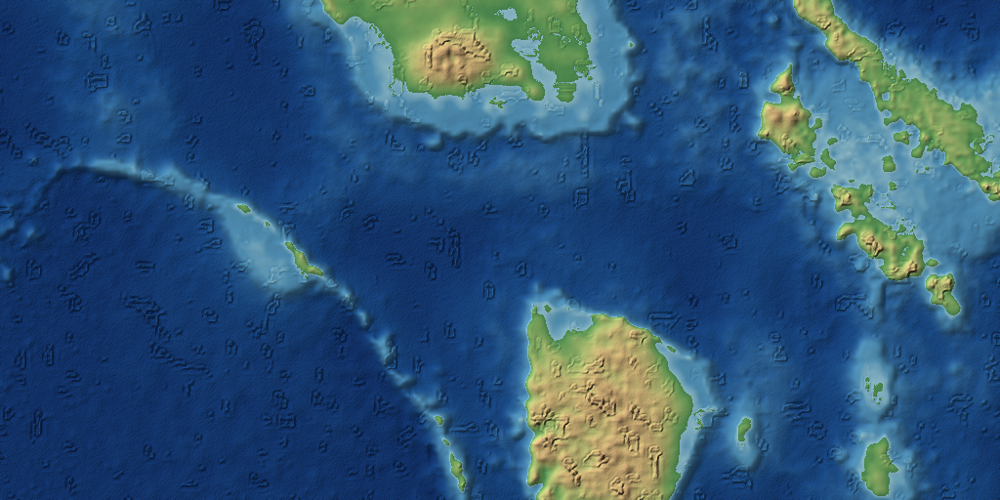

*Figure 1. Worm-like artefacts from the first refiner run, about 3,800 km wide.*

## 6. Results

Sections 6.1 to 6.12 use the first world model, now `models/experiments/world_r1_10a.pt`. Since
section 6.13, `models/world.pt` is a second run with the same settings; the refiners are unchanged.

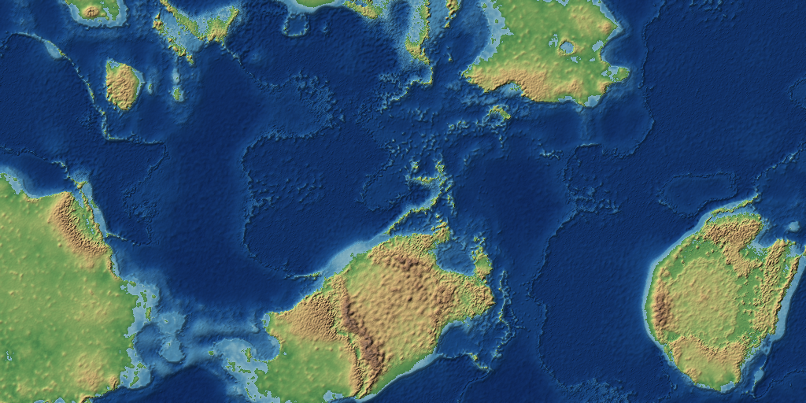

*Figure 2. Level 0 only, seed 0, about 15,200 × 7,600 km.*

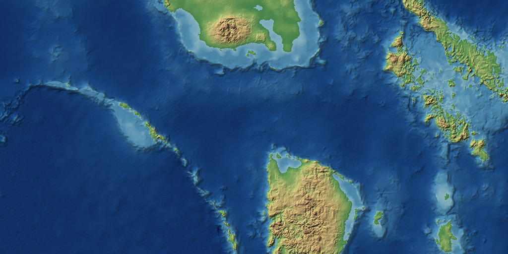

*Figure 3. Levels 0 and 1, seed 0, about 3,800 × 1,900 km, showing the generated
world refined.*

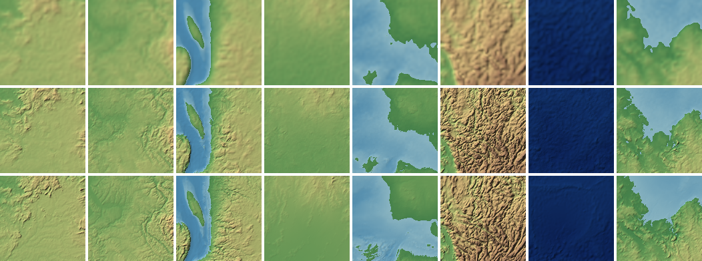

*Figure 4. Level 1 on real coarse input. Rows: upsampled input, refined output, real.*

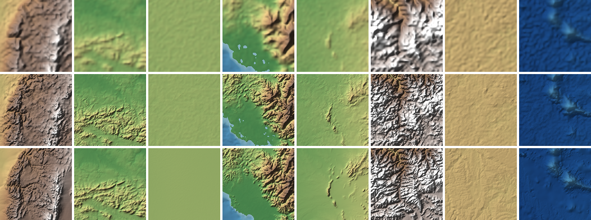

*Figure 5. Level 2 on real coarse input. Rows: upsampled input, refined output, real.*

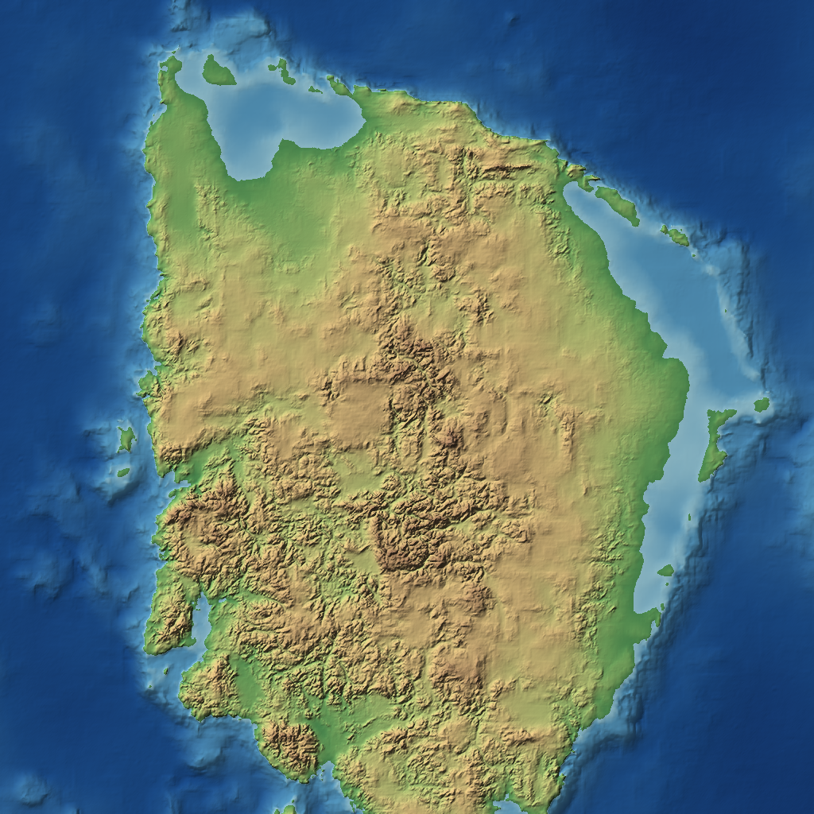

*Figure 6. All three levels, about 950 km wide, `--lon 20.7 --lat -14`, seed 0.*

### 6.1 Seamlessness

Comparing a large render with separately rendered parts gave these largest differences
in normalised height, on trained models:

| Model | Maximum difference |
|---|---|
| Level 1 cascade | 1.3 × 10⁻⁶ |
| All three levels | 3.6 × 10⁻⁷ |

This is floating-point noise. The test suite also checks untrained models at world
positions near 10⁹ pixels, to a tolerance of 10⁻⁴.

### 6.2 Variety at level 0

Over 256 tiles at step 20,000 (spread is the standard deviation across tiles):

| Statistic | Generated | Real | Distance between distributions |
|---|---|---|---|
| Land fraction spread | 0.36 | 0.36 | 0.077 |
| Height variation spread (m) | 686 | 665 | 219 |
| Roughness spread (m/km) | 2.36 | 3.79 | 1.26 |

Distance is the 1-Wasserstein distance over tiles. Land and height match well. Roughness
spread is too low, staying between 2.4 and 2.8 from step 8,000 on, so more training at
this level may not fix it. The readings vary between checkpoints, and land distance was
lowest at step 16,000 (0.044), while we use the final step.

### 6.3 Memorisation at level 0

For 24 varied generated tiles, we found the best normalised correlation anywhere on
real Earth, across eight orientations and six latitude bands. For the baseline, we did
the same with 24 real crops, excluding their own neighbourhoods.

| | Median best match | Highest | Above 0.95 |
|---|---|---|---|
| Generated | 0.805 | 0.977 | 12% |
| Real baseline | 0.807 | 0.952 | 4% |

Medians agree. The upper tail is slightly higher for generated tiles, but 12% and 4% are
about three tiles and one. The six closest pairs, inspected visually, were different
terrain sharing a similar coast orientation, not copies. This check compares overall shape
on small samples. Section 6.14 repeats it with more tiles, for the current world model and both refiners.

### 6.4 Refiner detail

Roughness ratios, generated over real, on one batch of real coarse input per checkpoint:

| Step | 2k | 4k | 6k | 8k | 10k | 12k | 14k | 16k | 18k | 20k |
|---|---|---|---|---|---|---|---|---|---|---|
| Level 1 | 1.08 | 0.87 | 0.66 | 0.98 | 0.90 | 1.10 | 0.94 | 0.98 | 1.06 | 0.97 |
| Level 2 | 0.85 | 1.01 | 0.99 | 1.12 | 0.96 | 1.13 | 0.94 | 0.93 | 0.94 | 1.02 |

These are single-batch readings, so swings such as 0.66 are mostly noise, and section 5
shows the measure can be fooled. Final block-mean mismatch with the input was about 0.005.

### 6.5 Qualitative assessment

Visually, generated results include rugged massifs, basins, coastal plains and offshore
islands, and refined outputs on real input are often hard to tell apart from real at a
glance. Weaknesses are consistent:

- Long rivers and continuous ridge lines rarely form, while real terrain shows them clearly.
- Long coastlines are too clean, and sea floors blur at finer levels, as refiners saw
  mostly land.
- Level-0 highlands are bumpy, some landmasses too round, and real trenches are mostly absent.
- Refined output on generated input is weaker than on real input.

### 6.6 Rendering speed

On the GTX 1650, most 256 px map tiles took about 0.05 s, and the most zoomed-out took about
1.4 s. These were single measurements and exclude browser time.

### 6.7 Terrain statistics

`measure.py` compares each level with real terrain over 512 tiles of 128 px, using the
training crop rules for both (land share at least 0.3, with 10% of other crops kept).
"Generated" is the whole cascade down to that level, from random worlds and places.
"Refined real" is the level's refiner on block means of the real crops. Bicubic and bilinear
upscale those same block means. "fBm noise" is fractal noise with the real mean power-law
spectrum, each tile scaled to the mean and spread of a random real tile, standing in for
classic procedural methods.

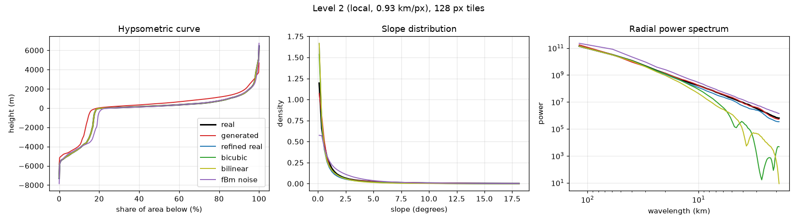

*Figure 7. Level 2: hypsometric curves, slope distributions and power spectra. The figures
for levels 0 and 1 are `docs/figures/stats_level0.png` and `stats_level1.png`.*

| Level 2, 0.93 km/px | Height error (m) | Slope ratio | Slope distance (°) | Fine spectrum (log₁₀) |
|---|---|---|---|---|
| Generated | | 1.04 | 0.09 | −0.01 |
| Refined real | 57 | 0.77 | 0.41 | −0.21 |
| Bicubic | 44 | 0.64 | 0.64 | −2.57 |
| Bilinear | 50 | 0.55 | 0.79 | −2.13 |
| fBm noise | | 1.43 | 0.75 | +0.27 |

Slope ratio is mean slope over the real mean. Slope distance is the 1-Wasserstein distance between
slope distributions. Fine spectrum is the mean log₁₀ power ratio against real at wavelengths of
2 to 8 px, where 0 is right and −1 is a tenth of the real power. Level 1 gives the same picture
(refined real: error 115 m against 91 m for bicubic, slope ratio 0.79 against 0.60).

**Refiners against upscaling (A2).** As Ledig et al. predict for GAN super-resolution, the
refiners have larger height errors than bicubic upscaling but far more realistic texture.
Bicubic output has about 1/300 of the real fine-scale power.

**Real against generated input (C1).** On real input the refiners add too little detail,
reaching 77–79% of the real slope. On generated input, slopes are close to real (ratio 1.04 at
level 2, 1.11 at level 1). This is no evidence that generated input is better: level 0 is too
rough (slope ratio 1.20), and the refiners pass that roughness down. Two errors cancel.

**Level 0.** Spectra match well, but the slope distribution lacks real Earth's peak of nearly
flat ground, in plains and abyssal plains, and the hypsometric curve shows a softened
continental shelf edge. Both fit the bumpy texture seen in section 6.5.

**Noise use (A1).** Rendering the same real input with a new latent field and new layer noise
leaves a correlation of 0.44 (level 1) and 0.43 (level 2) in the added detail, measured against
bilinear upscaling. A new layer noise alone leaves 0.87–0.91. The refiners therefore do not
ignore their randomness, unlike the generator of Isola et al. Most variation comes from the
latent field, and the correlated part is a deterministic sharpening of the input.

**Zoom consistency (A7).** Block means of generated levels 1 and 2 differ from the level above by
36 and 16 m RMS, small against their height ranges.

**Repetition (A8).** Correlations between random pairs of level-0 tiles, best of eight
orientations on 32 px versions, have a median of 0.46 for generated tiles and 0.40 for real
(0.7% and 0.2% above 0.9). Generated worlds repeat their forms slightly more than Earth, but not
enough to suggest mode collapse.

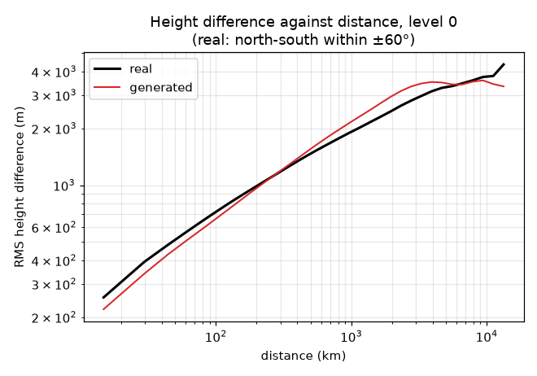

*Figure 8. RMS height difference between points a given distance apart, north to south.
Real: within ±60° latitude. Generated: eight 1,024 px worlds at level 0.*

**Long distances (A6).** Up to about 400 km, generated and real height differences agree. From
about 1,000 to 3,000 km generated worlds differ too much (2,131 against 1,891 m at 965 km, 3,335
against 2,806 m at 2,776 km) and level off sooner. Generated continents and oceans alternate
on a shorter scale than real ones, as section 7 predicts for the limited reach of level 0.

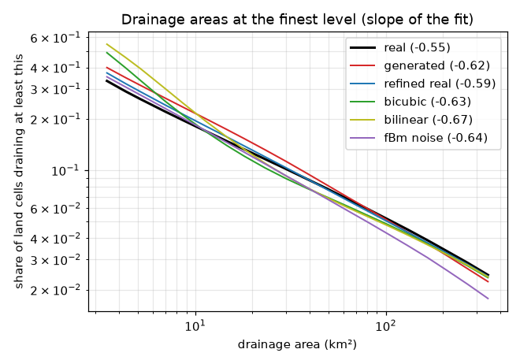

*Figure 9. Drainage areas at level 2 over 256 tiles: the share of land cells draining at
least a given area, with the fitted slope.*

**Drainage (A5).** We filled depressions by priority flood (Barnes et al., 2014) and routed water to
the steepest neighbour (D8), with the sea and tile edges as outlets. Real land at level 2 has
5.3% of its cells in closed depressions (mean fill 0.5 m). Generated land has 9.9% (3.6 m) and
fractal noise 18.7% (8.0 m). For real river networks the share of cells draining at least
area *a* falls roughly as *a*^−0.43 (Rodríguez-Iturbe and Rinaldo, 1997). Our real tiles give
−0.56, as 118 km tiles cut off large basins. Generated tiles give −0.62, refined real input
−0.59, bicubic −0.63 and fractal noise −0.64. A steeper slope means water gathers into large
rivers less. This makes the missing rivers of section 6.5 measurable: they are clearly better
than noise, but behind real terrain and behind refined real input.

**Fractal noise (F1).** Even with the real spectrum, fractal noise has slopes 43% too steep at
level 2 and twice too steep at level 0, and the worst drainage. Matching the spectrum alone
does not give realistic terrain, and the GANs are well ahead of this baseline.

### 6.8 Slower latent fields at level 0

To test the reach argument of section 7, we retrained level 0 with 16 more latent channels on a
lattice every 32 cells (512 px, about 7,600 km), interpolated like the existing smooth field
(`train.py --slow-ch 16`, 20,000 steps, everything else unchanged). Within a 128 px training
crop this field is nearly constant, so it acts as a regional style.

| Level 0 | Current | Slow field | Real |
|---|---|---|---|
| RMS difference at 965 km (m) | 2,131 | 1,804 | 1,891 |
| RMS difference at 2,776 km (m) | 3,335 | 2,649 | 2,806 |
| Slope ratio | 1.20 | 1.10 | 1 |
| Tile slope spread (°) | 0.16 | 0.14 | 0.25 |
| Pair similarity, median | 0.46 | 0.36 | 0.40 |
| Height distance (m) | 282 | 343 | 0 |

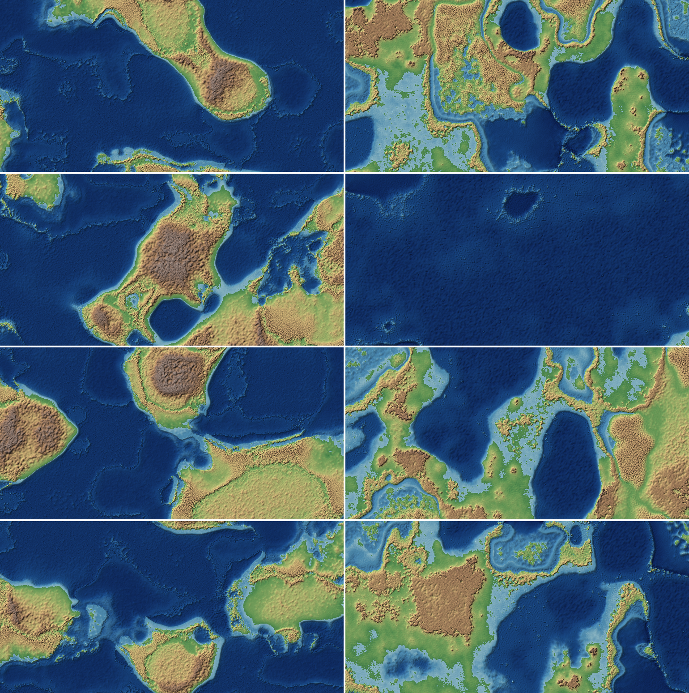

*Figure 10. Seeds 1 to 4, about 11,400 × 5,700 km. Left: current level 0. Right: with the slow field.*

The distance curve moves close to real Earth, and worlds now differ in their overall
character, from almost pure ocean to land-rich. Visually, though, the change is mixed: the
new model draws speckled shallow flats full of tiny islands and plateaus with sharp edges,
and still some ring-shaped basins. We keep the current level 0 as the default. The refiners
were not retrained for the new level 0.

### 6.9 Converged single-scale baseline

The cascade had only been compared with a single-scale model stopped at 7,300 steps. We trained the
same level-0 generator directly at 0.93 km per pixel for 20,000 steps (`train.py --downsample 1`),
like each cascade level, and compared it with the full cascade at the same scale. The discriminator
gained the upper hand late in this run (loss 0.17 at the end), so it is not a perfectly healthy
baseline, but its variety statistics improved steadily until then.

| 0.93 km/px, 128 px tiles | Single scale | Cascade | Real |
|---|---|---|---|
| Slope ratio | 1.20 | 1.04 | 1 |
| Slope distance (°) | 0.48 | 0.09 | 0 |
| Height distance (m) | 787 | 386 | 0 |
| Tile slope spread (°) | 1.76 | 2.14 | 2.05–2.22 |
| Pair similarity, median | 0.62 | 0.45 | 0.40 |
| RMS difference at 66 km (m) | 1,280 | 511 | 626 |
| RMS difference at 191 km (m) | 2,090 | 901 | 992 |
| Land in closed depressions | 15.5% | 9.9% | 5.3–6.0% |
| Drainage area exponent | −0.57 | −0.62 | −0.56 to −0.57 |

Real values differ slightly between the two runs, which drew different real crops. The distance
row for the cascade comes from eight 1,024 px renders of level 2, like the single-scale one.

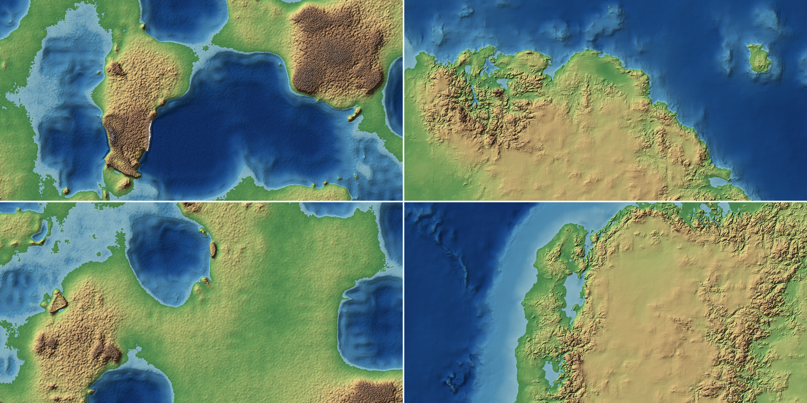

*Figure 11. About 950 × 475 km at 0.93 km per pixel, at places with 30–70% land. Left: single scale.
Right: cascade.*

The single-scale model repeats one look everywhere: tiles are far more alike than real ones
(median 0.62 against 0.40), and its land and sea alternate every 100 km or so, where real terrain
and the cascade change gradually over hundreds of kilometres. Visually it gives grainy uplands and
round seas, while the cascade gives coasts, valley systems and lakes. Its one better number is the
drainage area exponent, though with half again as much land in closed depressions as the cascade.
This supports the central claim: the homogeneity was structural, and the cascade, not
longer training, removes it at this scale.

### 6.10 Blurred coarse input at level 2

Section 6.7 found that refiners add too little detail to real input, but about the right amount to
generated input, because level 0 is too rough. Ho et al. (2022) blur the coarse input during
training so that later stages tolerate imperfect output from earlier ones. We retrained the level-2
refiner with the same recipe and step count, but with each coarse training input blurred by a
Gaussian with σ drawn uniformly from 0 to 1 coarse pixel (`train_refiner.py --coarse-blur 1.0`).
The consistency loss still compares the output with the unblurred input. All numbers are at level 2,
from 512 tiles, with the current levels 0 and 1 above.

| 0.93 km/px | Current refiner | Blurred input | Real |
|---|---|---|---|
| Slope ratio, real input | 0.77 | 0.92 | 1 |
| Fine spectrum, real input (log₁₀) | −0.21 | −0.07 | 0 |
| Height RMSE to real, real input (m) | 57 | 66 | 0 |
| Slope ratio, generated input | 1.04 | 1.27 | 1 |
| Block-mean RMS against level 1 (m) | 16 | 28 | – |
| Land in closed depressions, generated | 9.9% | 11.8% | 5.3% |
| Land in closed depressions, real input | 5.6% | 8.9% | 5.3% |
| Drainage area exponent, generated | −0.62 | −0.61 | −0.56 |

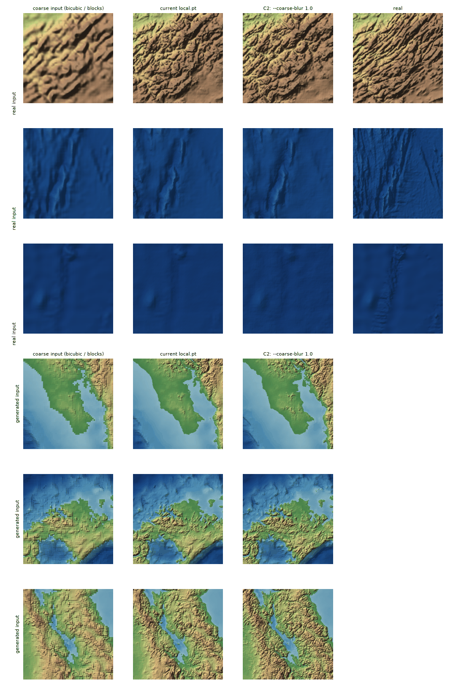

*Figure 12. 237 km tiles at level 2. Top three rows: real coarse input, refined by each model, and
the real terrain. Bottom three: the same generated worlds with each refiner. The real rows show
sea floor, as crops were picked by height variation.*

On real input the blurred-input refiner comes much closer to real slopes and fine-scale spectra,
and its ridges look sharper, at the cost of a larger height error. But it did not become less
sensitive to the input: it adds more detail to every input, and the ratio between generated and
real input stays at about 1.35. With today's level 0 the full cascade becomes too rough, and closed
depressions increase. The model is kept as `models/experiments/local_blur.pt`, and `models/local.pt`
stays the default. Blur looks worth keeping once level 0 is smoother, as the two errors would then
no longer cancel. This is one run per setting, so differences of a few percent may be noise.

### 6.11 Stronger R1 at level 0

As level 0 is too rough, and that roughness passes down the cascade, we retrained it with an R1
weight of 40 instead of 10, otherwise unchanged. A stronger penalty keeps the discriminator
smoother, which might weaken its push towards fine detail. Numbers are for generated terrain at
each level, with the current refiners below, from 512 tiles.

| Generated terrain | R1 = 10 (current) | R1 = 40 | R1 = 80 | Real |
|---|---|---|---|---|
| Level 0 slope ratio | 1.20 | 1.13 | 1.06 | 1 |
| Level 0 height distance (m) | 282 | 138 | 235 | 0 |
| Level 1 slope ratio | 1.11 | 1.00 | 0.75 | 1 |
| Level 2 slope ratio | 1.04 | 0.95 | 0.68 | 1 |
| Level 2 land in closed depressions | 9.9% | 8.3% | 6.8% | 5.3% |
| Level 2 drainage area exponent | −0.62 | −0.62 | −0.61 | −0.56 |
| Pair similarity, median | 0.46 | 0.44 | 0.44 | 0.40 |
| RMS difference at 965 km (m) | 2,131 | 2,044 | 2,124 | 1,891 |

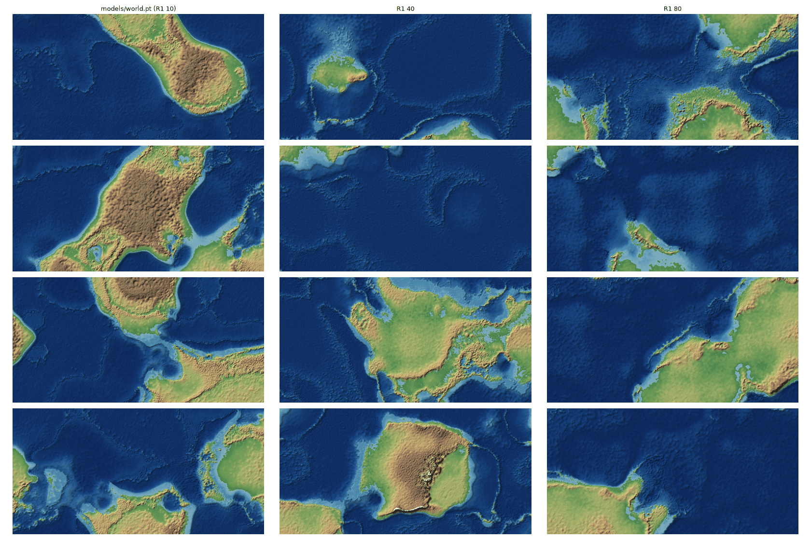

*Figure 13. Level 0, 7,600 × 3,800 km, seeds 1 to 4. Left to right: R1 = 10, 40 and 80. The same
seed gives an unrelated world with different weights.*

Every statistic moves towards real, and the improvement carries through to the levels below.
Visually, the stronger penalty gives broad lowland plains and wide shallow shelves, which the
current model rarely makes, and fewer round, domed continents. But it also gives speckled
shallow flats along some coasts, as in section 6.8, and at least one sharp escarpment. Kept as
`models/experiments/world_r1_40.pt`.

R1 = 80 goes too far. Level 0 slopes come closest to real (1.06), but mountains and mid-ocean ridges
mostly disappear, the sea floor turns blurry and the height distribution moves away from real again.
Below it, the cascade is too smooth (0.68 at level 2), as the refiners now add as little detail to
generated input as to real input (section 6.7). A rough level 0 thus hid the refiners' detail
deficit, and fixing one requires fixing the other. Kept as `models/experiments/world_r1_80.pt`.
Each weight is one run.

### 6.12 Smoother level 0 with blurred-input refiners

Sections 6.10 and 6.11 suggest fixing both errors at once: a smoother level 0, and refiners that
add more detail. We trained the level-1 refiner with blurred input as well (`--coarse-blur 1.0`,
20,000 steps), which raises its slopes on real input from 79% to 90% of real. Then we measured
the cascade with both blurred-input refiners below the R1 = 40 and R1 = 80 level-0 models.

| Generated, level 2 | Current | R1 40, current refiners | R1 40, blurred | R1 80, blurred | Real |
|---|---|---|---|---|---|
| Slope ratio | 1.04 | 0.95 | 1.15 | 1.03 | 1 |
| Slope distance (°) | 0.09 | 0.32 | 0.29 | 0.15 | 0 |
| Spectrum, middle / fine (log₁₀) | 0.01 / −0.01 | 0.13 / 0.02 | 0.16 / 0.08 | 0.00 / 0.02 | 0 |
| Tile slope spread (°) | 2.14 | 2.38 | 2.31 | 1.95 | 2.05 |
| Height distance (m) | 386 | 299 | 299 | 104 | 0 |
| Land in closed depressions | 9.9% | 8.3% | 12.4% | 11.1% | 5.3% |
| Block-mean RMS, level 1 against 0 (m) | 36 | 35 | 57 | 50 | – |

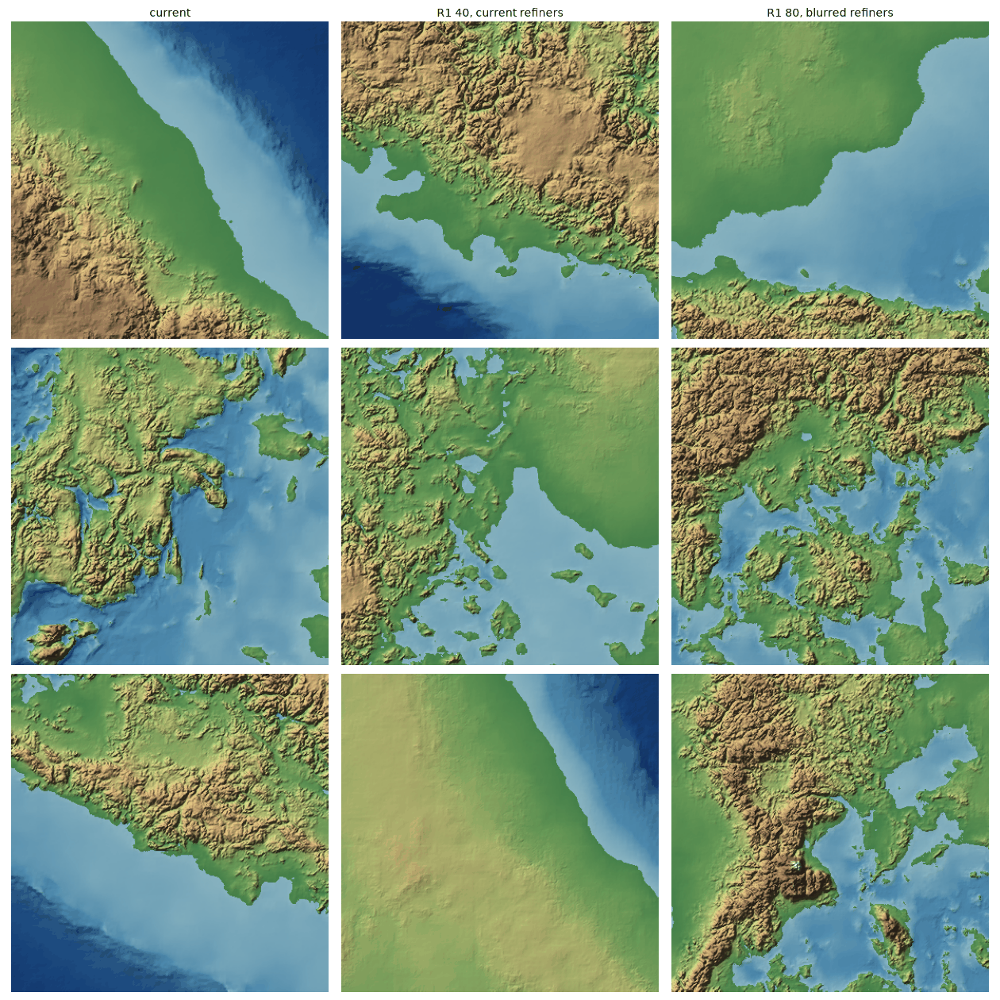

*Figure 14. 356 km tiles at level 2, at random places with 40–90% land in the level-0 map. Left:
current models. Middle: R1 = 40 with the current refiners. Right: R1 = 80 with both blurred-input
refiners. Columns show different places.*

With R1 = 80 and both blurred refiners, most statistics at level 2 are the closest to real so far,
including the height distribution, and the pictures show sharp ranges, plains and archipelagos.
Three costs remain: more closed depressions, level 1 departing further from its input (50 against
36 m), and the blurred, ridge-poor sea floor of the R1 = 80 level 0. Single runs throughout, and
the slope distance of the current cascade, which is lower, partly reflects two errors cancelling.

An R1 = 60 level 0 does not fall between the other two. Its level-0 slope ratio is 1.15, as rough
as R1 = 40, with large bumpy plateaus, and with both blurred refiners it reaches 1.12 at level 2,
with 11.6% of land in closed depressions. Across 10, 40, 60 and 80, level-0 roughness thus does not
fall steadily with R1 (1.20, 1.13, 1.15, 1.06), and differences between training runs may be as
large as the effect of R1.

A second R1 = 80 run, from a different random start, again gives a smooth level 0 (slope ratio
0.98), so that effect of the strong penalty holds. With both blurred refiners below it, though,
level 2 comes out too smooth (0.84, against 1.03 for the first run), with 11.1% of land in closed
depressions. Level 0 differs between the two runs by only 0.08 in slope ratio, but level 2 by 0.19:
the refiners amplify small differences at level 0, so the whole cascade's roughness rests on
level 0. Only the first run's combination matches real at level 2, which may be partly luck.

Combined with the blurred-input refiner of section 6.10, this smoother level 0 gives a level-2 slope
ratio of 1.08, with too much power at middle wavelengths (+0.21 in log₁₀) and 10.2% of land in
closed depressions. That is no better than the current refiner below the same level 0 (0.95 and
8.3%), so blur does not yet pay off: the real-input gain is smaller than the excess it adds.

### 6.13 Repeated runs and a single score

Sections 6.11 and 6.12 rest on one run per R1 weight, except R1 = 80. We repeated the level-0
runs at R1 = 10 and 40 from different random starts. To compare many model sets in one number
per level, `measure.py` now also computes the multi-scale sliced Wasserstein distance (SWD) of
Karras et al. (2018): 7×7 patches of a four-level Laplacian pyramid, compared through 512 random
projections, and averaged over the three detail bands (×1000; lower is closer to real). Unlike
Karras et al., both sets are normalised with the real set's statistics, so that a difference in
roughness counts. Different real crops score 12, 11 and 31 at levels 0, 1 and 2, the floor for a
perfect model; bicubic upscaling of real input scores 234 and 221 at levels 1 and 2.

| Generated, 512 tiles | L0 slope ratio | L2 slope ratio | L2 height distance (m) | SWD L0 | SWD L1 | SWD L2 | L2 closed depressions |
|---|---|---|---|---|---|---|---|
| R1 10, run 1 (default) | 1.20 | 1.04 | 386 | 133 | 86 | 125 | 9.9% |
| R1 10, run 2 | 1.08 | 0.92 | 148 | 92 | 95 | 128 | 7.1% |
| R1 40, run 1 | 1.13 | 0.95 | 299 | 84 | 70 | 127 | 8.3% |
| R1 40, run 2 | 1.42 | 1.14 | 296 | 174 | 85 | 110 | 8.3% |
| R1 80, run 1 | 1.06 | 0.68 | 95 | 74 | 93 | 141 | 6.8% |
| R1 80, run 2 | 0.98 | 0.56 | 209 | 32 | 136 | 182 | 6.8% |
| R1 10, run 2, blurred refiners | 1.08 | 1.19 | 148 | 92 | 107 | 193 | 11.9% |
| R1 40, run 2, blurred refiners | 1.42 | 1.53 | 287 | 174 | 145 | 275 | 12.8% |
| R1 80, run 1, blurred refiners | 1.06 | 1.03 | 104 | 74 | 55 | 142 | 11.1% |
| R1 80, run 2, blurred refiners | 0.98 | 0.84 | 200 | 32 | 65 | 109 | 11.1% |
| Real (other crops) | 1 | 1 | 44 | 12 | 11 | 31 | 5.3% |

Rows without "blurred" use the current refiners. The real crops of this table and of section 6.7
differ, so values for the default differ slightly from there.

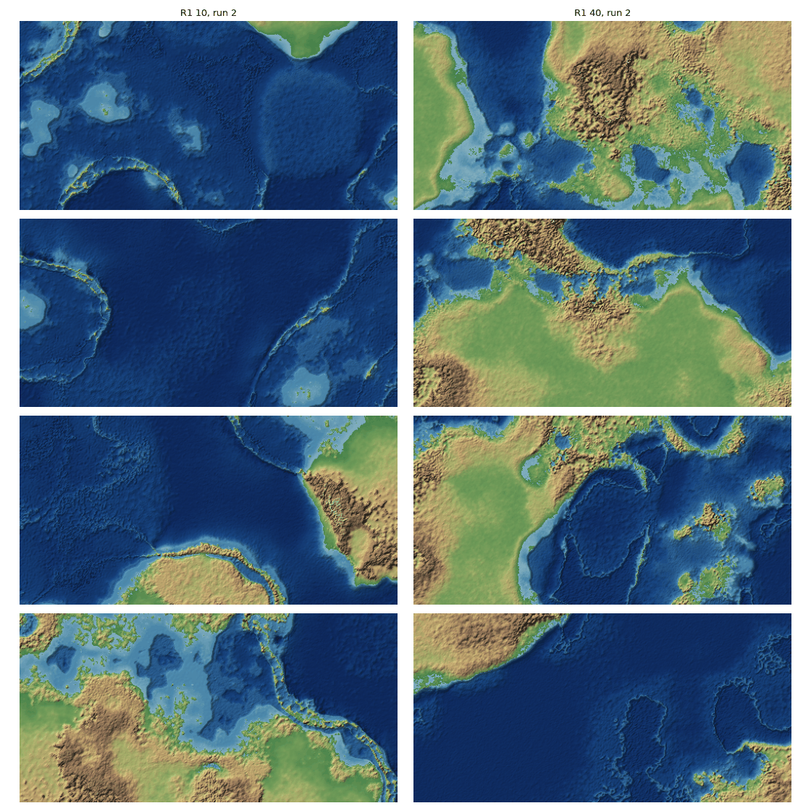

*Figure 15. Level 0, seeds 1 to 4, of the repeated runs. Left: R1 = 10. Right: R1 = 40.*

Run-to-run spread at level 0 is large: slope ratios of 1.20 and 1.08 at R1 = 10, and 1.13 and
1.42 at R1 = 40. Only R1 = 80 made level 0 smooth both times. So the trend of section 6.11 was
mostly chance, apart from the strongest penalty. The refiners pass level 0's roughness on, and
the blurred-input refiners only suit a smooth level 0. On real input they are clearly better
(SWD at level 2: 70 against 115 for the current refiner), but on rough generated input they make
things worse.

The second R1 = 10 run is the most Earth-like world model so far by eye, with island arcs,
trenches, rifts and coastal ranges (Figure 15, left), and with the current refiners it improves
on the default in most statistics: height distance 148 against 386 m, 7.1% against 9.9% of land
in closed depressions, and lower SWD at level 0. A practical recipe follows: train several level-0
models, which costs about 3 hours each, and keep the one that measures best. We did so, and the
second R1 = 10 run is now the default world model, `models/world.pt`; the first is kept as
`models/experiments/world_r1_10a.pt`.

### 6.14 Memorisation at every level

We repeated the check of section 6.3 with 64 tiles per set, for the current world model and
both refiners (`evaluate.py`, which now takes a whole cascade). A refiner's tile takes its
overall shape from the level above, so at levels 1 and 2 we compared detail only: each tile
minus its 4×4 block means, upsampled bilinearly, which is what the refiner adds. Earth's
latitude bands were filtered in the same way. A refiner that copied training crops would
reproduce their detail and score near 1. We also used 32 px tiles, in case copying is local.

| Level, tile size | Generated median | Generated highest | Real median | Real highest |
|---|---|---|---|---|
| 0, 128 px (1,900 km), whole tile | 0.816 | 0.976 | 0.811 | 0.962 |
| 1, 128 px (475 km), detail | 0.211 | 0.621 | 0.232 | 0.547 |
| 1, 32 px (119 km), detail | 0.467 | 0.797 | 0.503 | 0.916 |
| 2, 128 px (119 km), detail | 0.236 | 0.665 | 0.234 | 0.561 |
| 2, 32 px (30 km), detail | 0.525 | 0.884 | 0.523 | 0.883 |

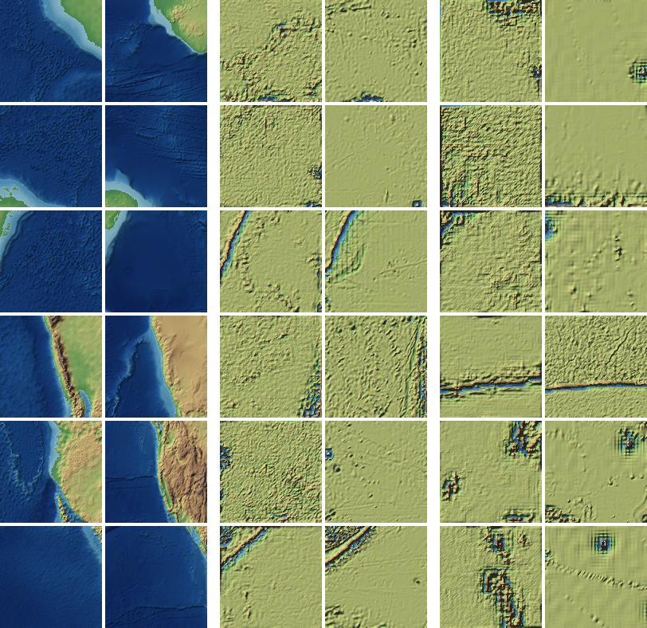

*Figure 16. The six closest pairs per level, generated on the left of each pair. Left to right:
level 0, then the detail of levels 1 and 2, each tile scaled to the same contrast.*

Generated and real crops find equally good matches at every level, and no tile comes near a
copy. At level 0, 8% of generated tiles match above 0.95 against 3% of real ones, as before:
coasts with a similar orientation. At the refiner levels, the highest matches share one strong
feature, such as a scarp, a ridge or a seamount, while the surrounding detail differs.

In Figure 16, generated detail looks like an even texture, and real detail like smooth ground
broken by one sharp feature. That impression is mostly selection: normalised correlation favours
real crops in which one feature carries all the detail. To check it, `measure.py` now reports the
share of each tile's detail energy (as defined above) that falls in its top 10% of 8 px blocks,
averaged over 512 random tiles. An even texture gives a low share, and isolated features a high one.

| Detail share in the top 10% of blocks | Level 1 | Level 2 |
|---|---|---|
| Real | 0.52 | 0.48 |
| Generated (cascade) | 0.53 | 0.44 |
| Refined real input | 0.60 | 0.52 |
| fBm noise | 0.17 | 0.17 |

Generated detail is about as concentrated as real detail, slightly more even at level 2, and far
from the uniform texture of fractal noise.

### 6.15 Best of four, and how noisy the scores are

To test the recipe of section 6.13, we trained two more level-0 models at R1 = 10 (runs 3 and 4),
four in all. First we checked how noisy the scores are. `measure.py --seed` draws a different
sample of 512 generated tiles while keeping the real ones. Over five samples of the default world
model, the level-0 slope ratio ranged from 1.08 to 1.13 and SWD from 92 to 123. The height
distance ranged from 126 to 233 m. Through the cascade, level-1 SWD ranged from 77 to 107 and
level-2 SWD from 128 to 141 over three samples. Single readings in the tables of sections 6.11 to
6.13 therefore carry about ±10 in SWD, and several of their differences are within that noise.

| Level 0, mean ± SD over samples | Slope ratio | SWD | Height distance (m) |
|---|---|---|---|
| Run 1 (5 samples) | 1.22 ± 0.01 | 131 ± 9 | 289 ± 33 |
| Run 2, default (5) | 1.12 ± 0.02 | 110 ± 11 | 153 ± 45 |
| Run 3 (5) | 1.10 ± 0.02 | 60 ± 7 | 99 ± 16 |
| Run 4 (3) | 1.10 ± 0.01 | 94 ± 8 | 266 ± 6 |

Within a run, checkpoints differ about as much as runs do. Level-0 SWD of the checkpoints at
10,000 to 20,000 steps ranged from 116 to 140 in run 1, from 92 to 150 in run 2, from 51 to 138
in run 3 and from 52 to 124 in run 4. Run 4 scored 52 to 64 between 12,000 and 18,000 steps
and 83 at the end. Checkpoints are free, so they add candidates at no training cost.

| Cascade, current refiners | L2 slope ratio | L2 height distance (m) | SWD L0 | SWD L1 | SWD L2 | L2 closed depressions |
|---|---|---|---|---|---|---|
| Run 1 | 1.04 | 386 | 133 | 86 | 125 | 9.9% |
| Run 2, default | 0.92 | 148 | 92 | 95 | 128 | 7.1% |
| Run 3 | 0.78 | 238 | 61 | 54 | 118 | 8.0% |
| Run 4 | 0.82 | 253 | 83 | 43 | 76 | 10.2% |
| Run 3, blurred-input level 1 | 0.90 | 226 | 61 | 54 | 83 | 10.4% |
| Real (other crops) | 1.02 | 44 | 12 | 11 | 31 | 6.0% |

One sample each; rows 1 and 2 are from section 6.13.

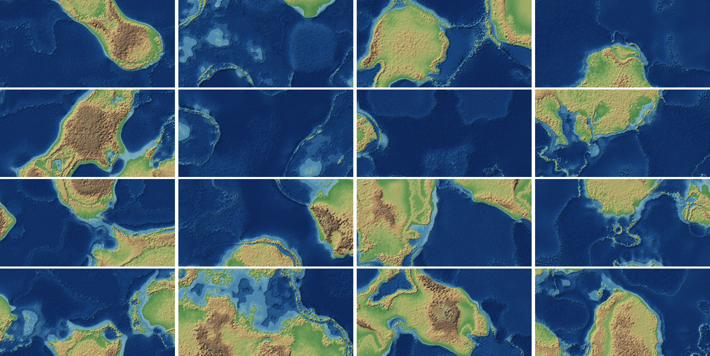

*Figure 17. Level 0, seeds 1 to 4, of the four R1 = 10 runs, runs 1 to 4 from left to right.*

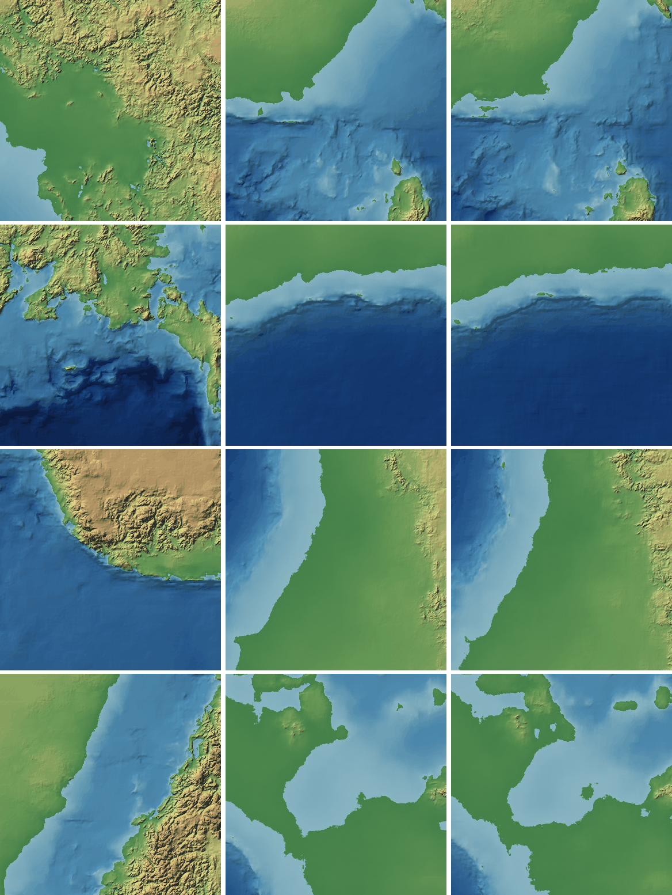

*Figure 18. 356 km at level 2, at places with 40–90% land in each world's level 0. Left: run 2,
the default. Middle: run 3. Right: run 3 with the blurred-input regional refiner.*

Runs 3 and 4 score better than the default at levels 0 and 1, and run 4 also at level 2, which
reaches the best SWD of any set so far (76). But both are smoother at level 2 (slope ratios 0.78
and 0.82), they lose the height distribution, and they have more closed depressions. In Figure 18,
run 3 gives broad, flat lowlands and shelves with few mountains, where the default has more relief.
The blurred-input regional refiner restores the slopes (0.90) and lowers level-2 SWD to 83, but adds
pits, as it did in section 6.12. Run 3's level 0 (Figure 17) has the most plains and continental
shelves, but some round mountain domes.

So no run wins on every measure, and the default stays. A smoother level 0 again exposes the
refiners' detail deficit, and the score of one level does not predict the next: level-0 SWD
ranked the runs 3, 4, 2, 1, but level-2 slope ranked them 1, 2, 4, 3. Choosing the best of several
needs the whole cascade measured, with several tile samples, and a decision on which measures
matter most. Each candidate costs about 12 minutes of CPU time to measure, against 3 hours of training.

## 7. Discussion

**Why a single scale looks homogeneous.** Our generators match the Spatial GAN setting:
convolutional, with identically distributed position-keyed inputs. Jetchev et al. (2016) show
such a process is stationary and mixing, and this predicts what we saw: the same statistics
everywhere, with nothing linking regions beyond the generator's reach. Stationarity does not
come from a lack of training, so it would not go away with more. This argument strengthens the
case that the fault was structural, and the converged baseline of section 6.9 confirms it.

**Why the cascade helps, and its limit.** The cascade does not remove stationarity, and only
moves its scale. Level 0 sees 1,900 km crops, so tile variety appears at a scale the viewer
notices, whereas the single-scale model saw only 120 km. Beyond the reach of level 0, about
1,400 km plus its 128 px smooth field, generated worlds should have no structure, such as
supercontinents or planet-wide tectonic patterns. Section 6.7 confirms that land and sea
alternate on too short a scale beyond about 1,000 km, and section 6.8 shows a slower latent
field fixing this statistic, at a visual cost. ALIS and InfinityGAN address global consistency directly.

**Why rivers are missing.** Rivers and ridges are organised over long distances. Each refiner
sees only about 10 coarse pixels, and level 0 has too little resolution, so no level is well
placed to create them. Under the patch-discriminator view of Isola et al. (2017), a limited
reach models terrain as a Markov random field, a texture model, and this fits with what we see.
Guérin et al. (2017) show a practical alternative: make rivers and ridges explicit conditional
inputs. Their learned erosion simulation suggests a post-process that could be slotted into a
cascade too. Neither has been tried here.

**Conditioning gap.** Refiners only ever saw real coarse maps during training, and quality
visibly drops on generated input. This is the compounding error that Ho et al. (2022) identify
in cascades. Our noise of σ = 0.01 is small, and was not searched. Their finding that blur works
better at high resolutions suggests it for level 2, although it comes from diffusion models
on photographs. Section 6.10 tried it: blur made the level-2 refiner add more detail to all inputs,
which helps on real input, but did not shrink the gap between real and generated input. The gap
seems to start at level 0, which is too rough, rather than in the refiners. Beckham and Pal (2017)
instead propose joint training for the same symptom.

## 8. Limitations of this evaluation

- No FID or other standard score, and no human perceptual study. InfinityGAN and ALIS report
  FID variants (ScaleInv FID, ∞-FID) and InfinityGAN a user study too, so our results cannot be
  compared with theirs. FID's Inception features were trained on photographs and so may suit
  heightmaps poorly. We use the multi-scale sliced Wasserstein distance of Karras et al. (2018)
  instead (section 6.13), which is not comparable with other papers either.
- Few controlled ablations. Several changes were made together, and most causes are hypotheses;
  sections 6.8 to 6.13 are the exceptions.
- Mostly one training run per configuration (sections 6.13 and 6.15 show the spread between runs is large), and all visual checks by the authors.
- Most scores come from one sample of 512 generated tiles, which carries about ±10 in SWD and
  ±0.02 in slope ratio (section 6.15).
- Section 6.7's statistics compare distributions, not structure, apart from the drainage
  check, which is limited by 118 km tiles. The memorisation check uses 64 tiles per level and
  compares whole tiles, so it would miss copying of features smaller than 30 km.
- Training stopped at 20,000 steps per level. Longer runs were not explored.
- Figures come from a few seeds and positions, chosen to include land.

## 9. Conclusion

A cascade of three small unpadded GANs with position-keyed randomness can generate an
endless, exactly seamless world spanning continents to about 1 km per pixel, within 4 GB
of GPU memory and about 8 hours of training time. The cascade addressed the homogeneity of a
single-scale model. Producing organised long-distance features such as river networks is
the main open problem, and theory on stationary generators suggests it will need a structural
change and not more training. Images alone caught a failure that our roughness metric missed, so
metrics and visual checks should be used together. Open questions are listed in
[TODO.md](TODO.md).

## References

Titles and first authors were checked against arXiv, Crossref or the papers. All were read in
part for this report (abstracts and relevant sections, not cover to cover). Venues were also
checked, except Ho et al.'s journal. Beckham and Pal, and Jetchev et al., are workshop papers
cited through arXiv. Barnes et al. and Rodríguez-Iturbe and Rinaldo were added for the
drainage check and cited from memory, without rereading.

- Barnes, R., Lehman, C., Mulla, D. (2014). Priority-flood: An optimal depression-filling and watershed-labeling algorithm for digital elevation models. Computers & Geosciences.
- Beckham, C., Pal, C. (2017). A step towards procedural terrain generation with GANs. arXiv:1707.03383.
- Bergmann, U., Jetchev, N., Vollgraf, R. (2017). Learning texture manifolds with the Periodic Spatial GAN. ICML.
- Guérin, É., et al. (2017). Interactive example-based terrain authoring with conditional generative adversarial networks. ACM Transactions on Graphics.
- Ho, J., et al. (2022). Cascaded diffusion models for high fidelity image generation. JMLR.
- Isola, P., et al. (2017). Image-to-image translation with conditional adversarial networks. CVPR.
- Jetchev, N., Bergmann, U., Vollgraf, R. (2016). Texture synthesis with spatial generative adversarial networks. arXiv:1611.08207.
- Karras, T., et al. (2018). Progressive growing of GANs for improved quality, stability, and variation. ICLR.
- Ledig, C., et al. (2017). Photo-realistic single image super-resolution using a generative adversarial network. CVPR.
- Lin, C. H., et al. (2022). InfinityGAN: Towards infinite-pixel image synthesis. ICLR.
- Mescheder, L., Geiger, A., Nowozin, S. (2018). Which training methods for GANs do actually converge? ICML.
- NOAA National Centers for Environmental Information (2022). ETOPO 2022 15 Arc-Second Global Relief Model. doi:10.25921/fd45-gt74. Accessed 1 November 2026.
- Rodríguez-Iturbe, I., Rinaldo, A. (1997). Fractal River Basins: Chance and Self-Organization. Cambridge University Press.
- Skorokhodov, I., Sotnikov, G., Elhoseiny, M. (2021). Aligning latent and image spaces to connect the unconnectable. ICCV.
