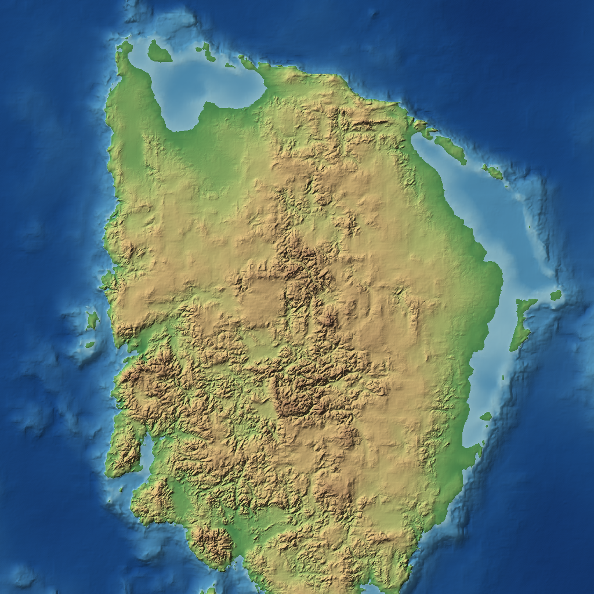

# Terrain GAN

Generates endless, seamless elevation maps with a cascade of three GANs trained
on the ETOPO 2022 global relief model. A world-scale generator invents continents
and oceans, and two refiners add detail down to about 0.93 km per pixel. Any piece
of the world can be rendered on its own, and tiles match without blending.



The method and results are written up in [PAPER.md](PAPER.md).

## Setup

Requires [uv](https://docs.astral.sh/uv/) and, for training, an NVIDIA GPU. The
models were trained on a GTX 1650 with 4 GB.

```sh
uv sync
uv run test_seamless.py   # optional: checks tile alignment and seamlessness
```

The trained models are in `models/`, so generating terrain needs no training
data. Training and the real-Earth map mode need
`ETOPO_2022_v1_30s_N90W180_bed.tif` in the project folder. It is not in git.

## Generate a tile

```sh
uv run generate.py --ckpt models/world.pt models/regional.pt models/local.pt \
    --lon 20.7 --lat -14 --size 1024 --seed 0 --out tile
```

This writes `tile.png` (shaded relief) and `tile.npy` (heights in metres, 32-bit
float, north up). List the world model first, then the refiners. Dropping refiners
gives a coarser result, as in the table below.

- `--lon` and `--lat` set the centre on an infinite plane. Values beyond ±180 and
  ±90 work, and they are not places on the real Earth.
- `--seed` selects the world. The same seed and position always give the same terrain.
- `--size` is in pixels at the finest level given.

## Browse the map

```sh
uv run serve.py --ckpt models/world.pt models/regional.pt models/local.pt
```

Open <http://127.0.0.1:8000/>. Pan, zoom and change the seed; the map picks the
right level for each zoom. The URL keeps the seed and position, so views can be
shared. The browser needs internet access, because OpenLayers loads from a CDN.

**Seed `-1` shows the real elevation data** at the same zoom levels, for direct
comparison. In this mode longitude and latitude are real places, for example
`/?seed=-1&lon=86.9&lat=28`. High latitudes look stretched east-west, because the
real data is not corrected for the map projection.

| Option | Default | Purpose |
|---|---|---|
| `--ckpt` | `runs/world/latest.pt` | Checkpoints, coarsest first; reloaded when they change |
| `--host` | `127.0.0.1` | Use `0.0.0.0` to allow other machines. There is no authentication |
| `--port` | `8000` | Port |
| `--device` | GPU if available | Use `cpu` while training, as sharing a 4 GB GPU risks running out of memory |
| `--data`, `--cache-dir` | ETOPO file, `cache` | Source of the seed `-1` data |

## The three levels

| Level | Model | Scale | A 128 px crop covers | Decides | Parameters |
|---|---|---|---|---|---|
| 0, world | `models/world.pt` | 14.8 km/px | ~1,900 km | Continents, oceans, mountain belts | 1.22 M |
| 1, regional | `models/regional.pt` | 3.7 km/px | ~475 km | Ranges, basins, coastlines | 0.42 M |
| 2, local | `models/local.pt` | 0.93 km/px | ~120 km | Ridges, valleys | 0.42 M |

## Train the models

The first run decompresses the TIFF into `cache/` (about 2 GB, plus smaller
downsampled copies). Each level took 2.5 to 3 hours at about 2 steps/s on the GTX
1650. These are the commands behind the included models:

```sh
uv run train.py --out runs/world --downsample 16 --min-land 0 \
    --steps 20000 --sample-every 2000 --save-every 2000

uv run train_refiner.py --out runs/regional --downsample 4 \
    --parent models/world.pt --steps 20000

uv run train_refiner.py --out runs/local --downsample 1 \
    --parent models/world.pt models/regional.pt --steps 20000
```

`train.py` defaults to 200,000 steps, so pass `--steps`.
Add `--resume` to continue from `<out>/latest.pt`. Each run writes:

- `samples_*.png`: for level 0, generated tiles above a row of real ones; for
  refiners, the upsampled input, the refined result and the real terrain in three rows.
- `world_*.png`: a fixed 1024×512 window of seed 0. At the finest level this window
  may be open ocean, so the sample images are the better check there.
- `generator_*.pt`: the small file for generating; `latest.pt`: the full state for resuming.
- TensorBoard logs, which `./tensorboard.sh` serves at <http://127.0.0.1:6006/>
  (add `--host 0.0.0.0` for other machines).

To stop Linux suspending during a long run:

```sh
systemd-inhibit --what=idle:sleep --why="GAN training" uv run train.py ...
```

### Reading the numbers

Judge the images as well as the metrics. One failed run reached a good roughness
score purely through artefacts (see the paper). Refiner roughness comes from a
single batch and is noisy. A discriminator loss near 1.39 means it cannot tell real
from fake, which is not a good sign if the difference is obvious by eye.

## Check for copying

`evaluate.py` compares generated tiles with the whole real Earth to detect a model
memorising its training data. Real crops, excluding their own location, are the baseline.

```sh
uv run evaluate.py --ckpt models/world.pt \
    --npy cache/ETOPO_2022_v1_30s_N90W180_bed_x16.npy --closest closest.png
```

It only handles a level-0 generator. Refiners are not supported.

## Project layout

| Path | Contents |
|---|---|
| `terrain_gan.py` | Networks, position-hashed noise, tile rendering, relief images |
| `train.py` | World generator training and data caching |
| `train_refiner.py` | Refiner training |
| `generate.py` | Model loading and tile generation |
| `serve.py` | OpenLayers map server and seed `-1` mode |
| `evaluate.py` | Copying check |
| `test_seamless.py` | Alignment and seamlessness tests |
| `models/` | Trained models |
| `docs/figures/` | Images used by the documentation |

`runs/`, `cache/` and the TIFF files are ignored by git.

## Limitations

- Long rivers and continuous ridge lines rarely form.
- Long coastlines are too smooth, and the ocean floor is blurry at the finest levels.
- Level 0 has too little variation in roughness, and some landmasses are too round.
- Refiners were trained on real coarse input, so results on generated worlds are
  weaker than the training samples suggest.
- ETOPO "bed" data has no ice sheets, so terrain resembles bedrock in those areas.
- Trained for 20,000 steps per level, with no quantitative score such as FID.
